# RideNow: Client

[](https://github.com/sruthi28021998/uber-clone-client/actions)

React frontend for a ride-hailing app (an Uber clone). Riders book rides, nearby drivers accept them, both follow the ride live, and the rider pays with Stripe, rates the driver and downloads a receipt.

**Live app:** https://uber-clone-client-nine.vercel.app
**Server repo:** [uber-clone-server](https://github.com/sruthi28021998/uber-clone-server)

## Screenshots

### 1. Home page
[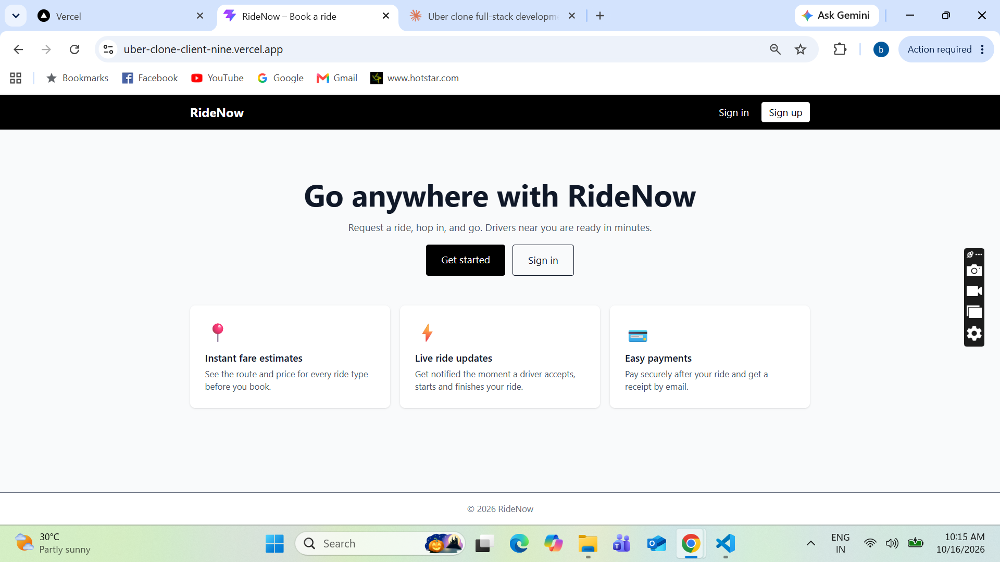](https://github.com/sruthi28021998/uber-clone-client/blob/main/docs/screenshots/01-home.png)

### 2. Sign in (Clerk)
[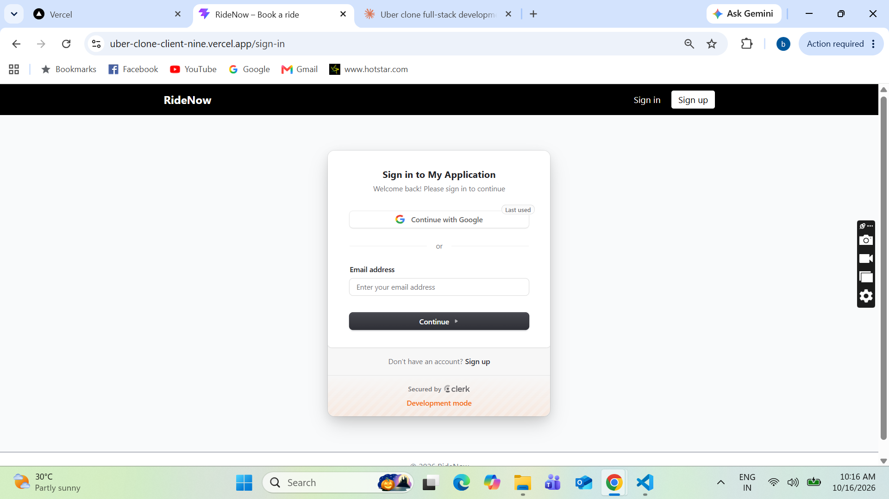](https://github.com/sruthi28021998/uber-clone-client/blob/main/docs/screenshots/02-sign-in.png)

### 3. Profile and role selection
[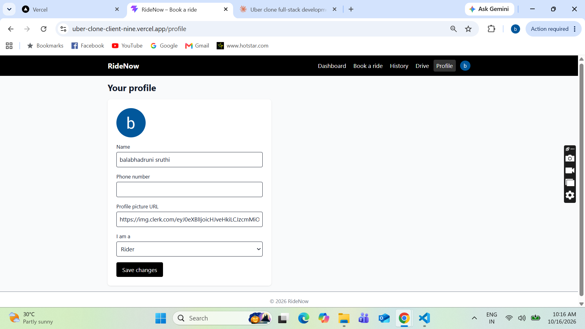](https://github.com/sruthi28021998/uber-clone-client/blob/main/docs/screenshots/03-profile.png)

### 4. Booking: map and fare options
[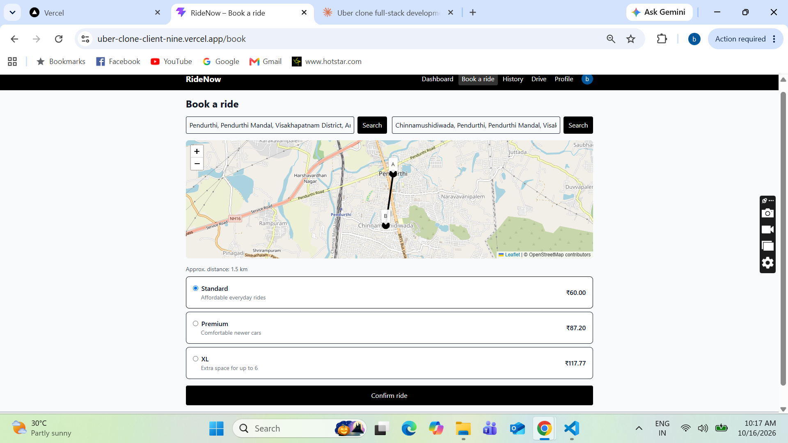](https://github.com/sruthi28021998/uber-clone-client/blob/main/docs/screenshots/04-book-ride.png)

### 5. Driver dashboard
[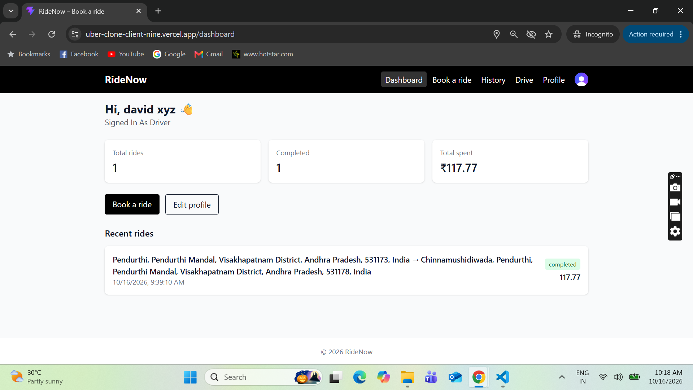](https://github.com/sruthi28021998/uber-clone-client/blob/main/docs/screenshots/05-driver-dashboard.png)

### 6. Live ride status
[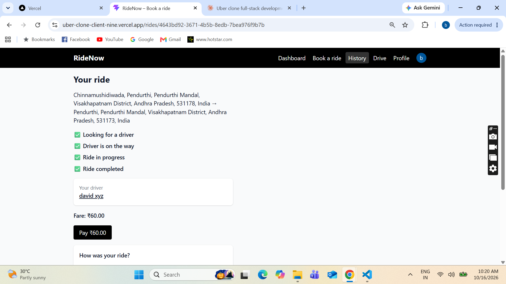](https://github.com/sruthi28021998/uber-clone-client/blob/main/docs/screenshots/06-ride-status.png)

### 7. Payment with Stripe Checkout (test mode)
[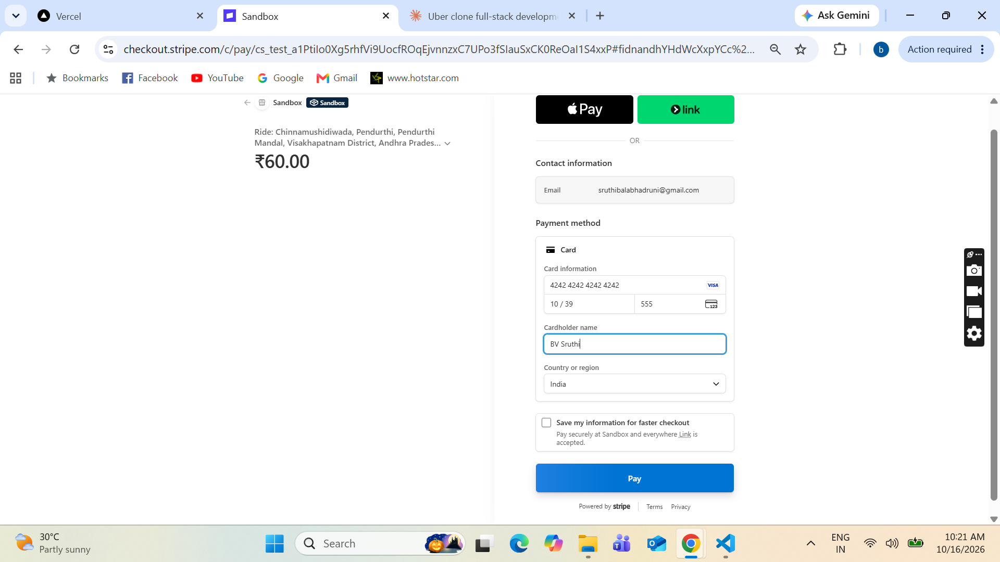](https://github.com/sruthi28021998/uber-clone-client/blob/main/docs/screenshots/07-stripe-checkout.png)

### 8. Paid ride
[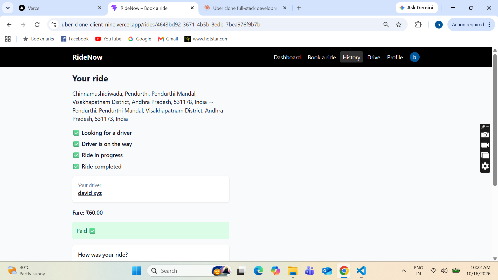](https://github.com/sruthi28021998/uber-clone-client/blob/main/docs/screenshots/08-paid.png)

### 9. Rating and review
[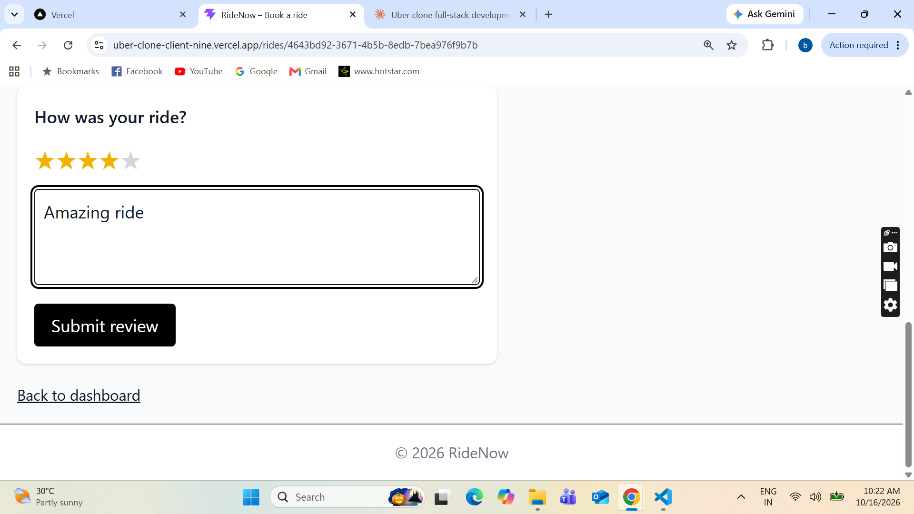](https://github.com/sruthi28021998/uber-clone-client/blob/main/docs/screenshots/09-review.png)

### 10. Ride history
[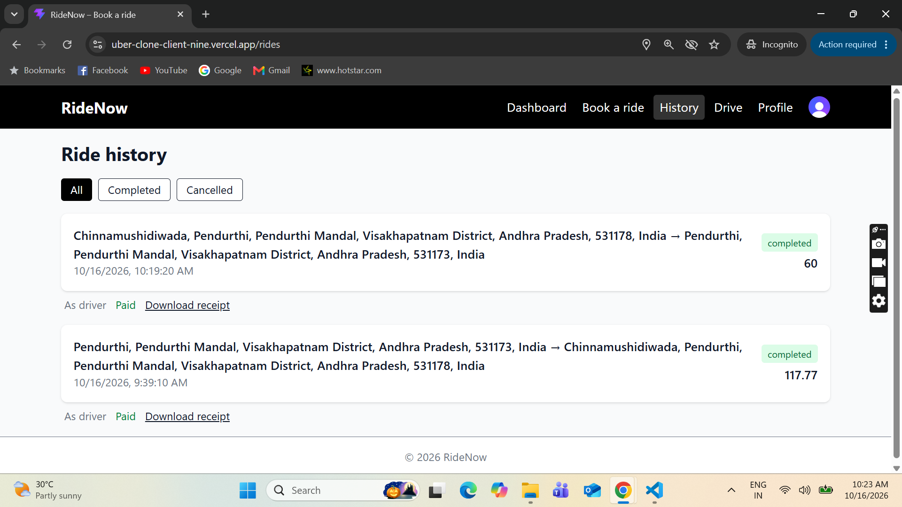](https://github.com/sruthi28021998/uber-clone-client/blob/main/docs/screenshots/10-history.png)

### 11. PDF receipt
[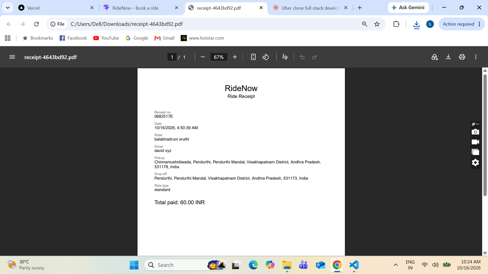](https://github.com/sruthi28021998/uber-clone-client/blob/main/docs/screenshots/11-receipt.png)

## Features
- Sign up and login with Clerk, with rider and driver roles
- Book a ride: place search, map with both points, and fares for Standard, Premium and XL
- Driver dashboard: go online, see requests within 10 km, accept, start and complete rides
- Live ride status and pop-up notifications (Socket.IO, with a 10-second refresh as backup)
- Payments through Stripe Checkout (test mode), with driver earnings
- Ratings, reviews and driver profiles
- Ride history with PDF receipts
- Responsive layout with a mobile menu, lazy-loaded pages and a 404 page

## Tech stack
React 19 (Vite), React Router, Tailwind CSS, Clerk, Socket.IO client, Leaflet and OpenStreetMap (Google Maps optional), Stripe Checkout, react-hot-toast

## How it works
1. The user signs in with Clerk, and the browser gets a session token.
2. Every API call sends the token to the server, which verifies it.
3. A rider books a ride, and the server saves it and notifies nearby drivers.
4. A driver accepts, starts and completes the ride, and the rider sees each step live.
5. The rider pays on Stripe's page. When Stripe sends them back, the server confirms the payment with Stripe.
6. The rider reviews the driver and can download a receipt.

## Getting started
```bash
git clone https://github.com/sruthi28021998/uber-clone-client.git
cd uber-clone-client
npm install
cp .env 
npm run dev
```
Start the [server](https://github.com/sruthi28021998/uber-clone-server) too. The app runs at http://localhost:5173.

## Environment variables
| Name | Purpose |
| --- | --- |
| `VITE_CLERK_PUBLISHABLE_KEY` | Clerk publishable key |
| `VITE_API_URL` | Backend URL, for example `http://localhost:5000` |
| `VITE_MAP_PROVIDER` | `osm` (free OpenStreetMap, default) or `google` |
| `VITE_GOOGLE_MAPS_API_KEY` | Only needed when the map provider is `google` |

The Stripe secret key lives only on the server. Nothing for Stripe is needed here.

## Scripts
| Command | What it does |
| --- | --- |
| `npm run dev` | Start the dev server |
| `npm run build` | Production build |
| `npm run lint` | Lint the code |

## Project structure
```
src/
├── components/   Navbar, Footer, RideCard, RatingStars, PayForRide, map components...
├── lib/          useApi (authenticated requests), SocketContext (live updates)
├── pages/        Home, Dashboard, BookRide, DriverDashboard, RideStatus, RideHistory...
├── App.jsx       Routes (lazy-loaded)
└── main.jsx      Clerk, router and socket providers
```

## Try it
1. Create two accounts, and set the second one to **Driver** in Profile.
2. Driver: open **Drive** and click **Offline** to go online.
3. Rider: **Book a ride**, pick two places and confirm.
4. Driver: accept, start and complete the ride.
5. Rider: pay with the Stripe test card `4242 4242 4242 4242` (any future date and CVC).
6. Rider: rate the driver, then open **History** to download the receipt.

## Deployment
Deployed on Vercel. Set the environment variables above in the project settings. `vercel.json` makes page refreshes work.

## Notes
- Payments run in Stripe's test mode, so no real money moves.
- Clerk runs in development mode, so a development label shows on the sign-in page.

Built by [@sruthi28021998](https://github.com/sruthi28021998)